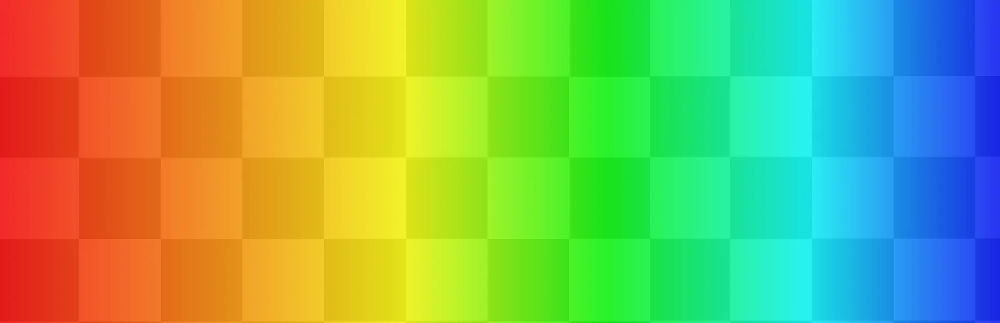
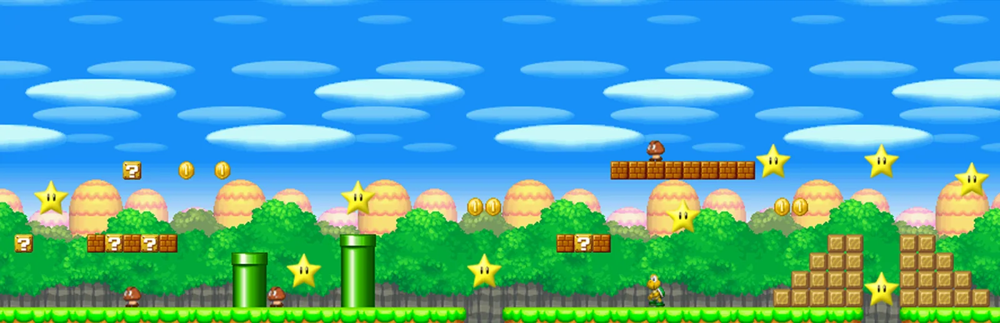
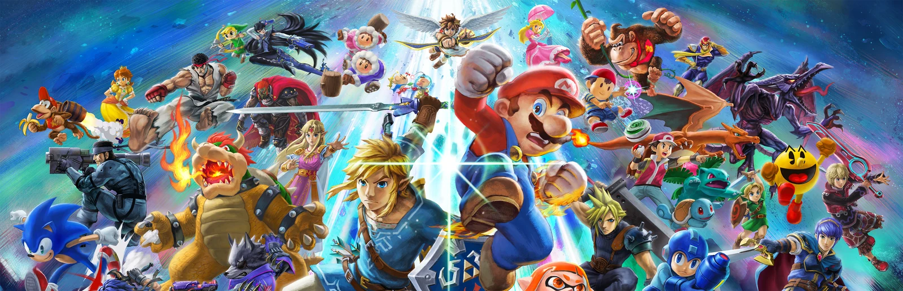

---
hide:
  - navigation
  - toc
---

<section class="home-hero">
  

    
CLUBHOUSE WORLD

    <h1>Pick a game.Get it running.</h1>
    
Straightforward setup guides for the games we play together, without the guesswork.

    

      <a class="home-button home-button--primary" href="games/">Browse all games</a>
      <a class="home-button home-button--secondary" href="#featured-guides">See the guides</a>
    

  

  

    
      
      
    
    
      
      
    
    
      
      
    
    
      
      
    
  

</section>

<section class="research-board" aria-labelledby="research-board-title">
  

    <h2 id="research-board-title">Bulletin board</h2>
  

  

    <article class="research-note">
      
      <h3>Next things I’m looking at</h3>
      <ul>
        <li>
          <button
            class="research-note__item"
            type="button"
            data-research-dialog
            data-research-title="Finish the Mario Party guide"
            data-research-status="Planned"
            data-research-status-tone="planned"
            data-research-details="mario-party-research-details"
            aria-haspopup="dialog"
          >
            Finish the Mario Party guide
            →
          </button>
          <template id="mario-party-research-details">
            <ul class="research-dialog__list">
              <li>Mario Party 1–3 can be played online on PC using <a href="https://github.com/MarioPartyNetplay/Mupen-MPN" target="_blank" rel="noopener">Mupen-MPN</a>. I still need to test how it works and how easy it is to set up.</li>
              <li>Mario Party 4–8 can be played online on PC using <a href="https://github.com/MarioPartyNetplay/Dolphin-MPN" target="_blank" rel="noopener">Dolphin-MPN</a>. I still need to test the games and learn what every player needs.</li>
              <li>Mario Party 4 also has a separate version called <a href="https://github.com/zeranemesis/Marioparty4" target="_blank" rel="noopener">Party Board</a> that supports two to four online players. I want to compare it with Dolphin-MPN.</li>
              <li>After testing everything, I’ll decide which option or options the finished guide should recommend.</li>
            </ul>
          </template>
        </li>
      </ul>
      
Select an item to see its current status and notes.

    </article>
  

</section>

<dialog class="research-dialog" data-research-modal aria-labelledby="research-dialog-title">
  

    

      
NOTICEBOARD UPDATE

      <h2 id="research-dialog-title" data-research-modal-title></h2>
    

    <button class="research-dialog__close" type="button" data-research-modal-close aria-label="Close update">×</button>
  

  

    
Current status

    

    
What I know so far

    

  

</dialog>

  

    
AVAILABLE GUIDES

    <h2 id="featured-guides">Choose your game</h2>
  

  <a href="games/">View all games →</a>

  <a class="game-card" href="retro-rewind/">
    
      
      
    
    Retro Rewind
  </a>
  <a class="game-card" href="mario-party/">
    
      
      
    
    Mario Party
  </a>
  <a class="game-card" href="mario-vs-luigi/">
    
      
      
    
    Mario vs. Luigi
  </a>
  <a class="game-card" href="sm64coopdx/">
    
      
      
    
    SM64CoopDX
  </a>
  <a class="game-card" href="super-smash-bros-ultimate/">
    
      
      
    
    Super Smash Bros. Ultimate
  </a>

  <strong>Built for quick starts.</strong>
  Find what you need, follow the steps, and get back to playing with friends.

